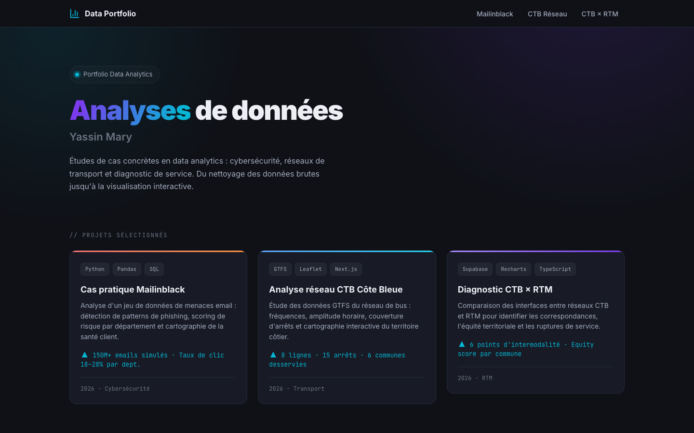

# Portfolio Data Analyst — Yassin Mary

Portfolio interactif de trois études de cas en analyse de données : cybersécurité email et réseaux de transport de la métropole marseillaise. Chaque étude part d'une question métier, s'appuie sur des données préparées en Python, et se termine par des indicateurs et des recommandations présentés dans un tableau de bord interactif.

**Site en ligne : [yassinmary.fr](https://yassinmary.fr)**



## Études de cas

### 1. Cybersécurité email — cas pratique Mailinblack

- **Question :** quels départements d'une entreprise sont les plus exposés au phishing, et quels clients risquent de décrocher ?
- **Méthode :** données simulées et calibrées sur les ordres de grandeur publics de Mailinblack (150 M de menaces bloquées en 2025), préparées en Python. Elles couvrent les menaces bloquées par catégorie, le taux de clic par département sur 4 campagnes de phishing, la complétion des formations Cyber Coach et un score de santé client composite (activation 50 %, adoption de la formation 30 %, exposition au phishing 20 %).
- **Résultats :** des taux de clic de 18 à 28 % selon le département, comparés à un benchmark sectoriel de 22 %. Les clients à risque sont identifiés par le score de santé.

### 2. Réseau de bus CTB Côte Bleue — données GTFS open data

- **Question :** comment est structuré le réseau de la Côte Bleue, et quelle offre propose-t-il réellement selon les lignes et les jours ?
- **Méthode :** analyse des fichiers GTFS publiés sur data.gouv.fr (mars à juillet 2026) : fréquences journalières, amplitude horaire, couverture hebdomadaire par ligne et carte interactive des arrêts.
- **Résultats :** 8 lignes, dont 2 à la demande, et 6 communes desservies. L'offre est très inégale d'une ligne à l'autre en fréquence et en jours de service.

### 3. Diagnostic intermodal CTB × RTM

- **Question :** la Côte Bleue est-elle équitablement reliée au réseau marseillais (métro, tramway, train) ?
- **Méthode :** croisement des données CTB avec les points d'interface RTM, calcul d'un ratio d'arrêts pour 1 000 habitants par commune et profil détaillé de la ligne C8 (liaison Côte Bleue – Gare Saint-Charles).
- **Résultats et recommandations :**
  - La C8 est la seule ligne en service le samedi (amplitude de 13 h 25). La renforcer permettrait de capter les flux touristiques du week-end.
  - Carry-le-Rouet a le ratio le plus faible hors Marseille (0,63 arrêt pour 1 000 habitants). Une ligne cadencée vers la gare améliorerait son accès.
  - Les correspondances avec les TER à Saint-Charles ne sont pas synchronisées. Aligner les horaires de la C8 réduirait l'attente.

## Stack

- **Préparation des données :** Python (Pandas), export vers Supabase (`export_to_supabase.py`)
- **Base de données :** Supabase (PostgreSQL), schéma et règles d'accès dans `supabase/schema.sql`
- **Front-end :** Next.js (export statique), TypeScript, Tailwind CSS
- **Visualisation :** Recharts, cartes Leaflet
- **Hébergement :** Netlify

## Lancer le projet en local

```bash
npm install
cp .env.local.example .env.local   # renseigner les clés Supabase (facultatif)
npm run dev
```

Le site tourne sur http://localhost:3000. Sans Supabase, toutes les pages fonctionnent avec les données statiques embarquées.

Pour alimenter Supabase : exécuter `supabase/schema.sql` dans l'éditeur SQL du projet, puis :

```bash
pip install supabase python-dotenv python-dateutil
python export_to_supabase.py
```
